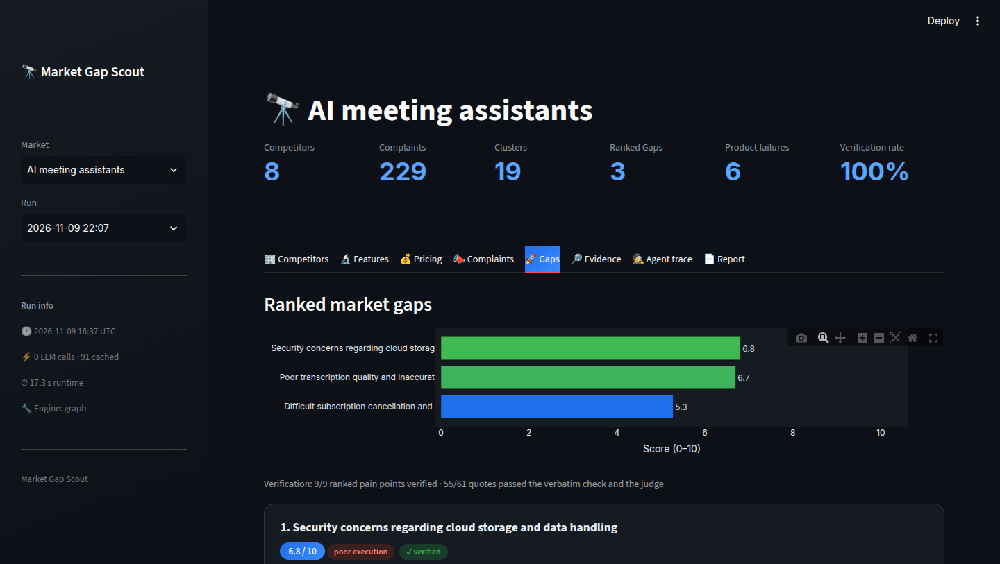
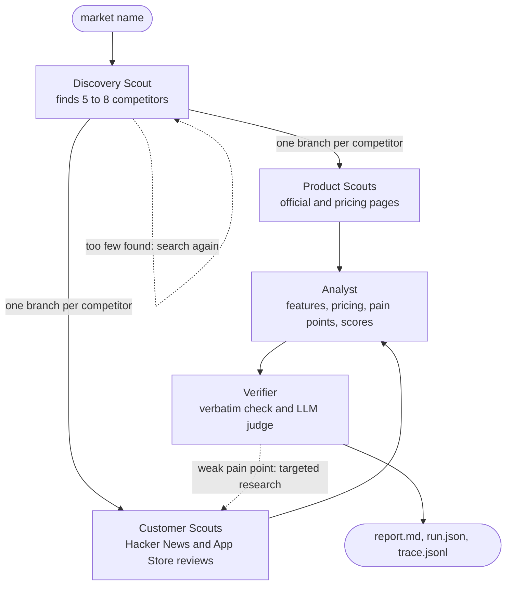
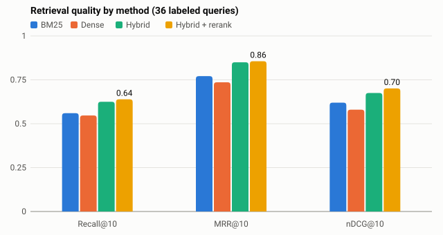
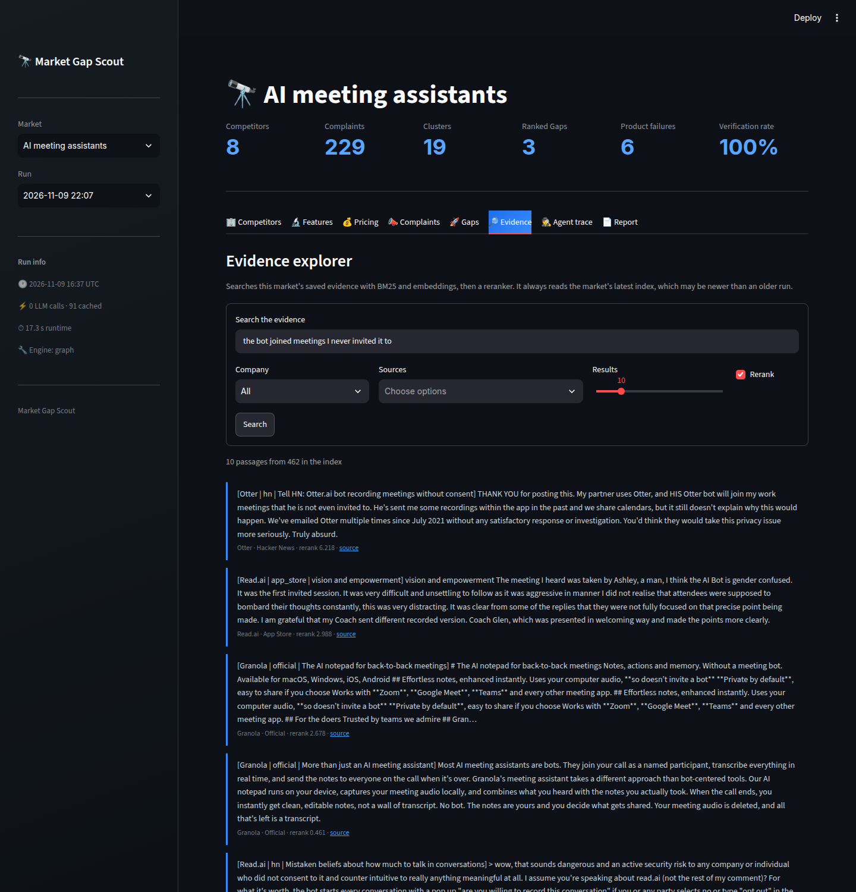
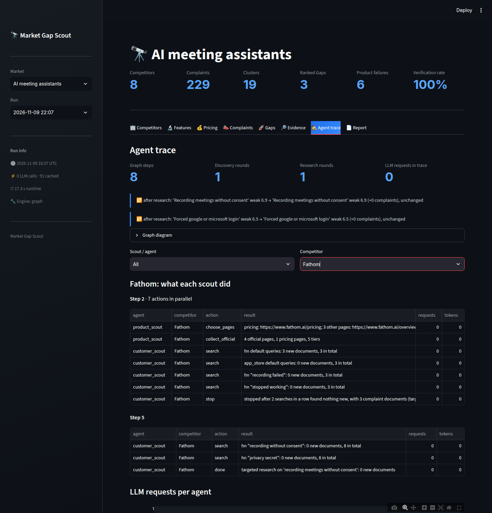

# Market Gap Scout

Give it a market, such as "AI meeting assistants". It finds the competitors, reads their own sites
and public customer complaints, and writes a cited report: a feature comparison, a pricing
comparison, the complaints grouped into pain points, and the market gaps those pain points point
to, each backed by quotes that were checked word for word.



**Example reports:** [AI meeting assistants](examples/ai-meeting-assistants.md) and
[AI calendar / scheduling assistants](examples/ai-calendar-scheduling-assistants.md). The second
market ran with no market-specific code.

## The problem

Product teams guess at market gaps from a handful of reviews and a competitor's landing page.
An LLM asked directly will invent gaps that sound plausible. This project does the reading at
scale and keeps every claim traceable:

- **A gap can only come from real complaints.** Complaints are extracted with a verbatim quote,
  grouped, and scored by code. The LLM never scores anything.
- **Every quote shown is checked twice:** it must appear word for word in its source, and a second
  call must agree that it supports the gap.
- **Bugs aren't gaps.** "The app crashes" is a product failure, not an opening for a new product,
  so failures are ranked apart from gaps.

## How it works

Five agents run as a LangGraph graph. Product and Customer Scouts run in parallel, one of each per
competitor, and the Verifier can send weak pain points back for more research.



- **Evidence store.** Every page and review goes into a hybrid index: BM25 and embeddings, fused by
  rank (RRF), then reranked by a cross-encoder. Coverage checks and the app's evidence search use it.
- **Scouts decide, code bounds them.** A scout picks the next search from a fixed set of actions, and
  stops at its step cap, when two searches in a row find nothing, or when collection has used 60% of
  the request budget.
- **Resumable and cached.** The graph is checkpointed to SQLite after every step, so a stopped run
  continues with `--resume`. Every fetch and LLM answer is cached, so a replay costs nothing.

### How a market gap is found

1. **Extract** complaints from reviews and comments, each with a verbatim quote and a 1–3 severity.
2. **Group** them: embeddings make first groups, and one LLM call regroups them into pain points and
   marks each a product failure or a need.
3. **Check coverage** for needs: does each competitor's own site claim to solve it?
4. **Score** in code: `score = 10 · (0.35·frequency + 0.25·severity + 0.25·gap + 0.15·evidence)`.
   Frequency is averaged over sources so the biggest source can't dominate.
5. **Gate:** a pain point is ranked only with at least 5 complaints from 3 documents about 2
   companies, and, for needs, from 2 kinds of source. The rest are listed as weak signals.
6. **Verify** the quotes. A pain point that fails can be sent back for targeted research.

The full design is in [SPEC.md](SPEC.md) §3–§4.

## Results

All numbers are in [eval/results/summary.md](eval/results/summary.md), including the aims missed.

| What | Aim | Result |
|---|---|---|
| Retrieval, 36 labeled queries | Hybrid + rerank beats each method alone | **Met:** nDCG@10 0.70, against 0.68 hybrid, 0.62 BM25, 0.58 dense |
| Competitor discovery | Recall of at least 0.8 | **Missed:** 0.62 and 0.67, the most possible with 8 competitors against 13 and 12 gold names |
| Pricing, every tier of 5 competitors | At least 90% exact | **Met:** 91% |
| Feature matrix, 30 random cells | At least 80% | **Met:** 97% |
| Clustering, 20 random assignments | At least 80% sensible | **Met** on the demo market (95%), **missed** on the second (70%) |
| Faithfulness | At least 95% of candidate quotes pass | **Missed:** 90% and 86%; only passing quotes reach a report |
| Multi-agent vs linear | More evidence for the budget | **Not shown** on cached demo data; on the second market, follow-up research found complaints the first pass missed |
| Cost | A fresh run fits the free quota | **Met:** 71 requests in 12 minutes (demo), 96 in 19 (second), against a cap of 200 |



## Quick start

Needs [uv](https://docs.astral.sh/uv/) and a free Gemini key from Google AI Studio.

```bash
git clone https://github.com/Pranav-Vyas/market_intelligence_agent.git
cd market_intelligence_agent
uv sync --extra ui                 # Python 3.12 and every dependency; no PyTorch
cp .env.example .env               # then add your key as GEMINI_API_KEY
uv run mia run "AI meeting assistants"
```

The report goes to `data/runs/<market>/<time>/report.md`. A fresh run takes about 70–100 requests
and 10–20 minutes; the first one also downloads about 220 MB of retrieval models.

**Windows:** the same commands work in PowerShell (install uv with
`powershell -ExecutionPolicy ByPass -c "irm https://astral.sh/uv/install.ps1 | iex"`, and use
`copy` instead of `cp`). If text looks garbled, run `$env:PYTHONUTF8=1` first. Not tested by us;
WSL with the commands above is the safe route.

### Without a key: replay a snapshot

A snapshot holds the cache of both markets, so the reports replay offline with no key or quota.
Ask the team for the zip (it is shared privately, never through git).

```bash
uv run mia snapshot restore path/to/snapshot.zip
uv run mia run "AI meeting assistants" --offline
uv run mia run "AI calendar / scheduling assistants" --offline
```

### Explore

```bash
uv run streamlit run app/streamlit_app.py                       # browse runs, search evidence
uv run mia search "too expensive" -m "AI meeting assistants" -c Otter   # search the evidence
uv run mia stats -m "AI meeting assistants"                     # documents per competitor and source
uv run mia run --resume <run-id>                                # continue a stopped run
uv run mia run "AI meeting assistants" --linear                 # the plain pipeline, for comparison
```

| Evidence search | Each scout's decisions |
|---|---|
|  |  |

## Design decisions

- **Gemini's free tier, through one thin layer.** All LLM calls go through `src/mia/llm.py`: cache,
  per-run budget, rate limit, retries with a 3-minute timeout, and a fallback chain. Flash allows
  about 20 requests a day, so only the feature list uses it; everything else runs on Flash-Lite,
  with a second Flash-Lite as backup when the first is overloaded.
- **No PyTorch.** Embeddings and reranking run on fastembed (ONNX), which keeps the install small
  and fast on a laptop CPU.
- **Code scores, LLMs extract.** Scores, gates and verification rates are plain code, so a report
  can be explained number by number.
- **Linear pipeline first, then the graph.** The graph's nodes call the same stage functions as the
  linear pipeline, so the two can be compared on the same data.
- **Pain points stay put between research rounds.** A research round only places new complaints, so
  a gap can't appear and vanish between rounds.
- **Data policy.** robots.txt is respected, at most one request per second per site, public pages
  only, and usernames are hashed. Reddit is left out (its API needs approval), and so are Google
  Play reviews (robots.txt) and review sites such as G2 and Trustpilot (their terms). See
  [docs/data_sources.md](docs/data_sources.md).

## Limitations

- **Mobile-heavy evidence.** App Store reviews are 75% of the demo market's complaints and 95% of
  the second market's, so mobile problems are over-represented. Frequency scores offset this, and
  each report says so.
- **Some products have almost no public complaints** (Fathom, Avoma and tl;dv; Trevor AI and
  Clockwise), so the gaps say little about them.
- **Results depend on the corpus and the prompts.** Grouping is one LLM call, so a newly collected
  corpus can give different pain points. Follow-up research also inflates the pain point it looks
  for.
- **"Unmet need" can overstate.** Coverage reads what vendors claim, so a price complaint can read as
  unmet even when free plans exist.
- **Hand checks are drafts.** The retrieval labels, hand-check verdicts and the second market's gold
  list were drafted with AI assistance and still need a person to confirm them.
- **Software markets only.** Prompts, sources and the comparison tables assume software products.

## Project layout

```
src/mia/            the package: cli.py, llm.py, pipeline.py, schemas.py, config.py
  agent/            the graph and its scouts
  collectors/       web pages, search, Hacker News, App Store
  rag/              chunking, BM25, embeddings, hybrid search, reranking
  analysis/         complaints, clustering, coverage, scoring, verification, features, pricing
  report/           Markdown report
app/                Streamlit app
eval/               evaluation scripts, gold labels and results
examples/           final reports for both markets
docs/               data sources and screenshots
tests/              offline tests (network tests are marked and skipped by default)
```

## Development

```bash
uv run pytest                                  # offline tests
uv run ruff check . && uv run ruff format .
```

Conventions for people and coding tools are in [AGENTS.md](AGENTS.md); the plan and contracts are in
[SPEC.md](SPEC.md).
