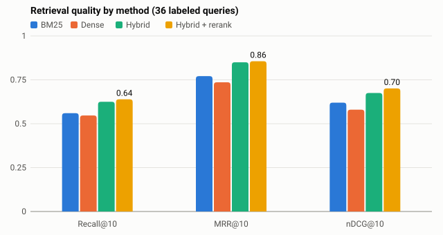

# Evaluation results

Two markets: **AI meeting assistants** (the demo market) and **AI calendar / scheduling
assistants**, which ran with no market-specific code. Details and commands are in
[eval/README.md](../README.md). These are the real numbers, including the aims we missed.

| What | How | Aim | Result |
|---|---|---|---|
| Retrieval | 36 labeled queries, demo market | Hybrid + rerank beats each single method | **Met:** nDCG@10 0.701, against 0.675 hybrid, 0.620 BM25 and 0.580 dense |
| Competitor discovery | Recall against hand-written gold lists | At least 0.8 | **Missed:** 0.62 (demo) and 0.67 (second). All of the first 8 found are on the gold lists |
| Pricing extraction | Every tier of 5 competitors | At least 90% exact | **Met:** 21 of 23, or 91% (87% before promotional prices were skipped) |
| Feature matrix | 30 random cells | At least 80% | **Met:** 29 of 30, or 97% |
| Clustering | 20 random complaint-to-cluster assignments per market | At least 80% sensible | **Met on the demo market:** 95%. **Missed on the second:** 70% (see below) |
| Faithfulness | Candidate quotes that pass the verbatim and judge checks | At least 95% | **Missed:** 90% (55 of 61) and 86% (75 of 87). Only passing quotes reach a report |
| Multi-agent vs linear | Same cached demo-market data | More evidence for the budget, or say honestly where not | **Not shown on this data:** same 229 complaints for 91 LLM calls vs 48; the graph read 2 more official pages |
| Cost and latency | Per fresh and cached run | Fresh run within the free quota | **Met:** 72 requests in 9.3 minutes (cap 200, measured before the Day 9 changes, which don't add calls); a cached replay uses 0 requests in about 20 seconds |

## Retrieval

| Method | Recall@10 | MRR@10 | nDCG@10 |
|---|---|---|---|
| BM25 | 0.560 | 0.771 | 0.620 |
| Dense | 0.547 | 0.736 | 0.580 |
| Hybrid | 0.625 | 0.850 | 0.675 |
| Hybrid + rerank | 0.639 | 0.856 | 0.701 |

Reranking costs about 1.4 seconds per query on a laptop CPU.

## Why the misses happened

- **Discovery.** A report keeps 8 competitors, so against gold lists of 13 and 12 names, recall
  can't exceed 0.62 and 0.67 at that cut. Both markets reach that ceiling, so the 0.8 aim can't be
  met as defined. Products found beyond the first 8 added no gold names, though. On the second
  market, discovery found AI planners but missed the booking-link tools (Cal.com, SavvyCal, Doodle,
  Acuity).
- **Pricing.** The 3 errors were promotional prices taken as annual prices, such as Otter's offer
  for India-issued cards. The extractor now skips promotions, and code drops a price the page only
  ever shows as one. Of the 2 errors left, one is now a missing price, not a wrong one: Otter
  Business's promotion is dropped, but its regular annual price wasn't found. Avoma's sale price
  is still taken.
- **Clustering on the second market.** The earlier 85% came from a run where the last research
  round regrouped every complaint from scratch, which happened to give better groups. Research
  rounds now keep the pain points they started with and only place new complaints, so a gap can't
  appear and then vanish between rounds. The report now shows round one's grouping, and 5 of the
  6 misplaced complaints sit in round-one groups. Samples of 20 also move by about 10 points.
- **Faithfulness.** Reading a sample of rejected quotes, most rejections were right: the quote didn't
  fit its pain point or was too vague alone. Loosening the check would only hide that.
- **Multi-agent.** Follow-up research found nothing new on the cached demo data. On the second
  market it added 13 complaints (206 to 219), so the benefit depends on the market.

## Limits

- **Reviewed by AI, not yet by people.** The hand-check verdicts, the retrieval labels and the
  second market's gold list were drafted with AI assistance and need a human spot-check.
- **Skewed sources.** App Store reviews are 75% of complaints in the demo market and 93% in the
  second, so mobile problems are over-represented. Scores offset this, and each report states it.
- **Results vary between runs.** Regrouping is one LLM call, so a new corpus or a changed prompt
  can merge, split or rename pain points. Within a run, research rounds now keep the pain points
  they start with. Before that change, a calendar-support gap on the second market ranked at 7.9
  after one round and was gone after the next; it now stays a weak signal at 3.7.
- **Thin evidence.** Some products have almost no public complaints: Fathom, Avoma and tl;dv in the
  demo market, and Trevor AI, Clockwise and Reclaim.ai in the second.
- **Overload.** When Flash-Lite was overloaded, one live run lost half its complaints but still
  exited normally. The app and report now flag this, and a backup model has since been added, though
  it hasn't yet been through a real overload.
